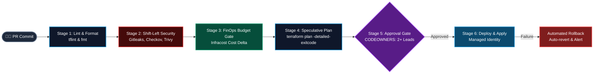

<div align="center">


<p align="center">
  
  
  
  
</p>

</div>

---

## 🧭 Overview

**DevSecOps Shield Pipeline** is a battle-tested, production-ready continuous delivery pipeline framework designed for **Azure DevOps Pipelines** and **GitHub Actions**.

It embeds **Shift-Left Security**, **Compliance as Code**, **FinOps Budget Guardrails**, and **Automated Drift Detection** directly into the pull request review lifecycle, ensuring zero insecure or unbudgeted infrastructure reaches production environments.



---

## ⚡ Key Pipeline Stages

| Stage | Tooling & Checks | Enforcement Target |
| :--- | :--- | :--- |
| **Stage 1: Quality & Linting** | `terraform fmt`, `tflint`, `terraform validate` | Syntax correctness, deprecated arguments, module style guides. |
| **Stage 2: Shift-Left Security** | `Gitleaks`, `Checkov`, `Trivy` | Zero committed secrets/API keys, CIS Azure benchmarks, container & IaC misconfigs. |
| **Stage 3: FinOps Budgeting** | `Infracost`, `scripts/cost-guardrail.py` | Automatically comments monthly cost impact on PRs; fails PR if delta exceeds threshold (e.g. +$250/mo). |
| **Stage 4: Speculative Plan & Drift** | `terraform plan -detailed-exitcode` | Validates target state and detects manual console drift during nightly scheduled runs. |
| **Stage 5: Production Deployment** | Azure Managed Identity, Blob Lease Locking | Zero permanent credentials in pipeline runners; automated rollback script on execution failure. |

---

## 📁 Repository Structure

```
.
├── .github/workflows/
│   └── devsecops-pipeline.yml   # Multi-stage GitHub Actions CI/CD workflow
├── azure-pipelines/
│   ├── azure-pipelines.yml      # Root Azure DevOps Pipeline
│   └── templates/
│       ├── validate-stage.yml   # Linting and syntax validation
│       ├── security-stage.yml   # Gitleaks, Checkov, Trivy steps
│       ├── finops-stage.yml     # Infracost budgeting gate
│       └── deploy-stage.yml     # Production apply with auto-rollback
├── scripts/
│   ├── drift-detector.sh        # Scheduled CLI drift auditing script
│   ├── cost-guardrail.py        # Python FinOps budget threshold gate
│   └── automated-rollback.sh    # Instant failover recovery script
├── sample-workload/             # Self-contained Terraform workload for testing
│   ├── main.tf
│   ├── variables.tf
│   └── outputs.tf
└── CODEOWNERS                   # Enterprise branch review policies
```

---

## 🚀 Setup & Execution

### 1. GitHub Actions Setup
1. Push this repository to GitHub.
2. In **Repository Settings ➔ Secrets & Variables ➔ Actions**, add:
   - `INFRACOST_API_KEY`: Infracost Cloud API Token.
   - `AZURE_CLIENT_ID`, `AZURE_TENANT_ID`, `AZURE_SUBSCRIPTION_ID`: OIDC Federated Credentials for Azure.
3. Open a Pull Request on a feature branch to see the automated security and cost gates in action!

### 2. Azure DevOps Setup
1. Create a new Pipeline pointing to `azure-pipelines/azure-pipelines.yml`.
2. Configure your Azure Service Connection (`sc-enterprise-azure-sub`) using Workload Identity Federation.
3. Run the pipeline — all 4 stages execute automatically with sequential approval gates.

---

## 🛡️ Drift Detection & Nightly Cron

Run the automated drift detector locally or via scheduled pipelines:

```bash
# Execute drift detection audit
bash scripts/drift-detector.sh sample-workload
```

---

## 👤 Author

**Swapnil Agarwal**  
*Senior DevSecOps Engineer & Azure Cloud Architect*  
- **Email:** [swapnilagarwal94@gmail.com](mailto:swapnilagarwal94@gmail.com)  
- **GitHub:** [@swapnilagarwal30](https://github.com/swapnilagarwal30)  
- **LinkedIn:** [Swapnil Agarwal](https://www.linkedin.com/in/swapnilagarwal30/)
